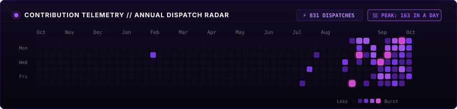

  
  
  

---

Hey, I'm **Akshit**.

I've always been the kind of person who can't leave a problem alone until I know exactly why it works — or why it doesn't. That itch is what pulled me into **computer vision, autonomous AI, and distributed systems**: the spaces where real sensors, live data, and models have to genuinely cooperate under pressure, not just in a notebook.

I don't really do black boxes. If I'm using something, I want to know what's happening three layers underneath — not because I have to, but because that's where the interesting stuff lives. Build lean, understand deeply, ship something that actually holds up. Cold coffee somewhere in the middle of all that.

---

### What I'm into

- **Vision & Edge** — I like the constraint of it. Real-time video under tight latency budgets, multi-target tracking, edge inference that holds up in the field and not just on a benchmark.
- **Autonomous Agents** — systems that can perceive, reason spatially, and act without someone holding their hand. The harder the task, the more interesting the design problem.
- **Speech & Audio** — acoustic modeling and voice pipelines that don't strip the personality out of someone's voice. The subtle parts are usually the hardest and most worth solving.
- **Distributed Systems** — the unglamorous side of scale that most people skip until something breaks at 3am. I'd rather think about it upfront.

---

### 📈 Output

  

<table>
  <tr>
    <td width="50%" align="center">
      
    </td>
    <td width="50%" align="center">
      
    </td>
  </tr>
</table>

---

### 🛠️ Stack

<table width="100%">
  <tbody>
    <tr>
      <td width="25%"><b>Languages</b></td>
      <td>
        
        
        
        
        
        
        
      </td>
    </tr>
    <tr>
      <td><b>Vision & AI</b></td>
      <td>
        
        
        
        
        
        
        
      </td>
    </tr>
    <tr>
      <td><b>Backend & Systems</b></td>
      <td>
        
        
        
        
        
        
        
      </td>
    </tr>
    <tr>
      <td><b>Frontend & UI</b></td>
      <td>
        
        
        
        
        
        
      </td>
    </tr>
  </tbody>
</table>

---

If something I'm building overlaps with something you're thinking about — or you just want to talk through a hard problem — I'm usually around.

  
  &nbsp;&nbsp;
  

